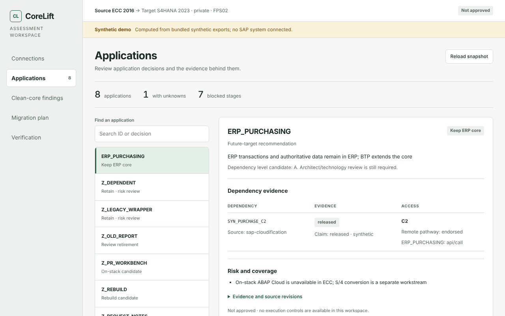

# CoreLift

CoreLift helps you move custom SAP code off the ERP core. You connect your SAP system; an AI coding agent (Claude Code or Codex) reads your custom ABAP, works out which apps can move and where, and drafts the new code for you to review.

It only reads from SAP. Nothing is ever written, transported or deployed to SAP or BTP. CoreLift is an early prototype, open source under Apache-2.0.



*The optional local workspace, showing the bundled demo assessment. See [developing and testing](docs/developer.md#open-the-local-workspace) to open it.*

## 1. Install

**Claude Code**

```sh
/plugin marketplace add codeyogi911/corelift
/plugin install corelift@corelift
```

**Codex**

```sh
codex plugin marketplace add codeyogi911/corelift
codex plugin add corelift@corelift
```

## 2. Try it, or connect your SAP system

No SAP system handy? Start your agent in an empty folder and ask:

> lift and shift my SAP custom code using the demo system

That uses a fictional SAP system, so you can see the whole flow in a few minutes.

To use your own system, ask your agent to "lift and shift my SAP custom code". If nothing is connected yet, it gives you one command to run in your terminal. That command asks for your SAP URL, client, user and password (the password is typed hidden), tests the connection read-only and saves it on your machine. Claude Code can also ask for these settings when you enable the plugin.

Your SAP user needs ADT display rights. See [connecting SAP](docs/sap-connection.md) for the exact authorizations and settings.

## 3. What happens next

1. **Discover.** The agent reads the custom code in the packages you choose.
2. **Assess.** It checks every SAP object your code uses against SAP's public Cloudification Repository and recommends a target for each app: keep it in ERP, move it to ABAP Cloud on the same system, move it to a BTP side-by-side app, rebuild it, retire it, or investigate further.
3. **Report.** You get a short table of your apps with each recommendation and its main blocker, plus a full `assessment.md`.
4. **Draft.** For the apps you pick, the agent writes the new target code and a `REVIEW.md` with open questions, all inside a local `corelift-workspace/` folder.
5. **You review.** You or your architect check the drafts and move them into your own system with your normal transport process.

Every recommendation is a candidate for review, not an SAP certification.

## Learn more

- [Connecting SAP and lifting apps](docs/sap-connection.md): what each step reads and writes, and its limits
- [Developing and testing CoreLift](docs/developer.md): offline demo, local workspace, host packages, running the checks
- [Architecture](docs/architecture.md) and [SAP decisions](docs/sap-decisions.md)
- [What has been verified](docs/validation.md)
- [Contributing](CONTRIBUTING.md) and [security reporting](SECURITY.md)

CoreLift is an independent project, not an SAP, OpenAI or Anthropic product. Never put credentials, customer code or proprietary SAP material in issues or pull requests. See [LICENSE](LICENSE) and [third-party notices](THIRD_PARTY.md).
